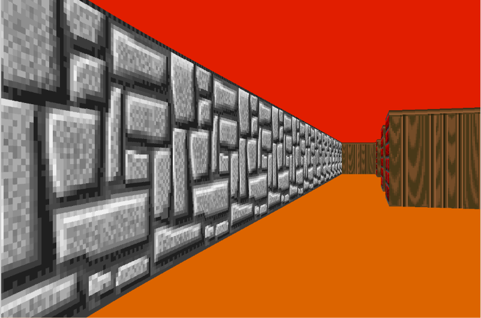

# cub3D

[🇬🇧 English](README.md) | 🇫🇷 Français

Un moteur de rendu 3D à la première personne écrit en C, inspiré de *Wolfenstein 3D*.
Il transforme une carte 2D en vue 3D texturée en temps réel grâce au **raycasting**.

Projet de groupe du cursus **42 Paris**, réalisé avec la bibliothèque graphique MiniLibX (X11).



---

## Fonctionnalités

- Raycasting en temps réel avec l'algorithme **DDA** (parcours de grille)
- **Murs texturés**, avec une texture différente selon l'orientation (N / S / E / O)
- Couleurs du sol et du plafond configurables
- Déplacements et rotation fluides, avec **glissement le long des murs** en cas de collision
- **Correction de l'effet fish-eye** (distance projetée sur l'axe du regard)
- Parsing strict du fichier de scène `.cub`, avec des messages d'erreur clairs

## Compilation et lancement

**Prérequis (Linux / WSL) :**

```bash
sudo apt install build-essential libx11-dev libxext-dev libbsd-dev
```

**Compilation :**

```bash
make
```

> Avec **gcc 15 ou plus récent** (norme C23 par défaut), la MiniLibX fournie ne compile pas telle quelle.
> Utiliser : `make CC="gcc -std=gnu17"`

**Lancement :**

```bash
./cub3D map.cub
```

## Commandes

<!-- TODO: vérifier les touches dans handle_events -->

| Touche | Action |
|---|---|
| `W` / `S` | Avancer / reculer |
| `A` / `D` | Pas latéral gauche / droite |
| `←` / `→` | Tourner la vue |
| `Échap` | Quitter |

## Fichier de scène (`.cub`)

```
NO ./srcs/textures/NORTH.xpm
SO ./srcs/textures/SOUTH.xpm
WE ./srcs/textures/WEST.xpm
EA ./srcs/textures/EAST.xpm

F 220,100,0
C 225,30,0

111111
100001
1000N1
111111
```

- `NO` / `SO` / `WE` / `EA` : textures des murs (`.xpm`)
- `F` / `C` : couleurs du sol et du plafond (RVB)
- Carte : `1` = mur, `0` = vide, `N` / `S` / `E` / `W` = position et orientation de départ du joueur
- La carte doit être entièrement fermée par des murs.

## Fonctionnement

Pour chaque colonne de l'écran :

1. Un rayon part du joueur avec un angle compris dans le champ de vision.
2. L'algorithme **DDA** avance dans la grille case par case jusqu'à toucher un mur,
   et note le côté touché.
3. La distance au mur est projetée sur l'axe du regard du joueur
   (`distance × cos(angle_rayon − angle_joueur)`) pour éviter l'effet fish-eye.
4. La hauteur de la colonne de mur est calculée à partir de cette distance.
5. Le point d'impact exact sur le mur (`wall_x`) détermine la colonne de texture,
   inversée sur certains côtés pour que les textures ne soient jamais affichées en miroir.

## Ma contribution

Projet réalisé en binôme avec [Sonia](https://github.com/sonia-iv).

**Mes parties :**
- **Raycasting – DDA** : parcours de la grille jusqu'au mur touché, distance au mur et côté touché (N/S/E/O)
- **Placage des textures** : point d'impact exact sur le mur, sélection de la colonne de texture (avec correction de l'orientation pour éviter les textures en miroir) et défilement vertical des pixels
- **Déplacements et collisions** : avancer/reculer, pas latéraux (vecteur perpendiculaire au regard), et collision testée **axe par axe** pour que le joueur glisse le long des murs au lieu d'être bloqué net
- **Parsing des textures** : identifiants NO/SO/EA/WE, détection des doublons par drapeaux binaires, vérification de l'existence des fichiers
- **Parsing du joueur** : position et orientation de départ

**Parties de Sonia :** lancement des rayons, calcul de la hauteur des murs, parsing et validation de la carte, mini-map et affichage des rayons sur la mini-map.

## Après la validation

Améliorations apportées après la validation du projet :

- **Correction du fish-eye** : la correction avait été perdue lors du remplacement
  de la première approche (rayons avancés par petits pas) par le DDA. Elle est de nouveau
  appliquée, uniquement à la hauteur des murs : le placage des textures utilise toujours
  la distance brute du rayon.
- Suppression des messages de débogage, correction du `.gitignore`.

## Structure du projet

```
includes/         en-têtes
srcs/raycasting/  DDA et boucle de lancement des rayons
srcs/render/      rendu des textures et buffer d'image
srcs/player/      initialisation et déplacements du joueur
srcs/utils/       fonctions utilitaires du DDA
libft/            bibliothèque C de 42
minilibx-linux/   MiniLibX (fournie par 42)
```
