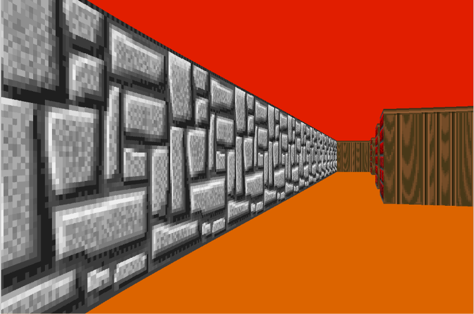

# cub3D

🇬🇧 English | [🇫🇷 Français](README.fr.md)

A first-person 3D maze renderer written in C, inspired by *Wolfenstein 3D*.
It turns a 2D grid map into a textured 3D view in real time using **raycasting**.

Team project from the **42 Paris** curriculum, built with the MiniLibX graphics library (X11).



---

## Features

- Real-time raycasting with the **DDA** algorithm (grid traversal)
- **Textured walls**, with a different texture for each orientation (N / S / E / W)
- Configurable floor and ceiling colors
- Smooth movement and rotation, with **wall sliding** on collision
- **Fish-eye correction** (distance projected onto the view direction)
- Strict parsing of the `.cub` scene file with clear error messages

## Build & run

**Requirements (Linux / WSL):**

```bash
sudo apt install build-essential libx11-dev libxext-dev libbsd-dev
```

**Build:**

```bash
make
```

> With **gcc 15 or newer** (C23 by default), the bundled MiniLibX does not compile as is.
> Use: `make CC="gcc -std=gnu17"`

**Run:**

```bash
./cub3D map.cub
```

## Controls

<!-- TODO: vérifier les touches dans handle_events -->

| Key | Action |
|---|---|
| `W` / `S` | Move forward / backward |
| `A` / `D` | Strafe left / right |
| `←` / `→` | Rotate the view |
| `Esc` | Quit |

## Scene file (`.cub`)

```
NO ./srcs/textures/NORTH.xpm
SO ./srcs/textures/SOUTH.xpm
WE ./srcs/textures/WEST.xpm
EA ./srcs/textures/EAST.xpm

F 220,100,0
C 225,30,0

111111
100001
1000N1
111111
```

- `NO` / `SO` / `WE` / `EA`: wall textures (`.xpm`)
- `F` / `C`: floor and ceiling colors (RGB)
- Map: `1` = wall, `0` = empty space, `N` / `S` / `E` / `W` = player start and orientation
- The map must be closed by walls.

## How it works

For each column of the screen:

1. A ray is cast from the player at an angle within the field of view.
2. The **DDA** algorithm steps through the grid cell by cell until it hits a wall,
   and records which side was hit.
3. The distance to the wall is projected onto the player's view direction
   (`distance × cos(ray_angle − player_angle)`) to avoid the fish-eye effect.
4. The wall slice height is computed from that distance.
5. The exact hit point on the wall (`wall_x`) selects the texture column,
   which is mirrored on some sides so textures are never displayed backwards.

## My contribution

Built in pair with [Sonia](https://github.com/sonia-iv).

**My parts:**
- **Raycasting – DDA**: grid traversal up to the hit wall, distance to the wall and wall side (N/S/E/W)
- **Texture mapping**: exact hit point on the wall, texture column selection (with orientation fix to avoid mirrored textures) and vertical pixel stepping
- **Movement & collisions**: forward/backward moves, strafing (vector perpendicular to the view direction), and collision checked **axis by axis** so the player slides along walls instead of stopping dead
- **Texture parsing**: NO/SO/EA/WE identifiers, duplicate detection with bit flags, file existence checks
- **Player parsing**: starting position and orientation

**Sonia's parts:** ray casting setup, wall height projection, map parsing and validation, minimap and ray display on the minimap.

## After evaluation

Improvements made after the project was validated:

- **Fish-eye fix**: the correction had been lost when the original ray-marching
  approach was replaced by DDA. It is now applied again, only to the wall height,
  so texture mapping still uses the raw ray distance.
- Removal of debug output, `.gitignore` fix.

## Project structure

```
includes/         headers
srcs/raycasting/  DDA and ray casting loop
srcs/render/      texture rendering and image buffer
srcs/player/      player initialization and movement
srcs/utils/       DDA helpers
libft/            42 C library
minilibx-linux/   MiniLibX (provided by 42)
```
